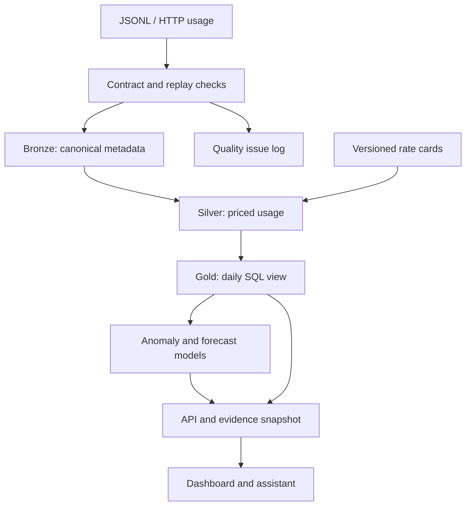

# TokenLedger AI

**AI cost intelligence, from usage event to evidence.**

[](https://github.com/sathwikpsp/data-ai-psp/actions/workflows/tokenledger-ci.yml)

A complete, runnable reference project for a current enterprise problem: understanding the cost of AI workloads before spending surprises become a habit. It combines data engineering, machine learning, a typed API, and a responsive dashboard in one reproducible package.

The [FinOps Foundation's 2026 report](https://data.finops.org/) identifies AI cost management as a leading priority. This project turns that use case into working software, with engineering choices and limits documented explicitly.

**The included 84-day dataset, provider names, model names, and prices are synthetic.** No credentials, customer data, paid model calls, or external accounts are needed. The evidence assistant is a constrained intent router over computed facts, not an LLM. Isolation Forest and Ridge provide the machine learning components.

## Run in three commands

Install Python 3.12 and [uv](https://docs.astral.sh/uv/getting-started/installation/), then:

```bash
cd projects/tokenledger-ai
uv sync --frozen --extra dev
uv run tokenledger demo
uv run tokenledger serve
```

Open **http://127.0.0.1:8000**. The dashboard shows spend, cost per successful request, team allocation, anomalies, forecasts, an editable budget scenario, and evidence-backed answers. Start with **“Why did costs spike?”**

Windows users can run the same `uv` commands in PowerShell. `make` is optional. The first installation downloads dependencies; the demo then runs locally without network calls.

Or use Docker:

```bash
docker compose up --build
```

The default Compose configuration is a local, synthetic demonstration bound to `127.0.0.1`. See [deployment](docs/deployment.md) for authenticated operation with real data.

## What is implemented

| Layer | Working functionality |
| --- | --- |
| Data contract | Schema version, timezone normalization, strict nonnegative tokens, bounded metadata, cache invariants, rejection of extra fields |
| Ingestion | Bounded JSONL batches and HTTP ingestion, exact replay detection, conflict quarantine, per-batch atomic writes |
| Cost warehouse | Sanitized bronze records, priced silver usage, daily gold SQL view, rate-card version history, micro-USD accounting |
| AI / ML | Per-team Isolation Forest plus materiality gates, weekday baselines, explainable signals, Ridge versus seasonal median forecasting |
| Evaluation | Chronological selection/calibration/test splits, precision/recall, WAPE/MAE, empirical interval coverage, reproducible evaluation report |
| Application | FastAPI, responsive JavaScript dashboard, scenario budget control, evidence assistant, static demo export |
| Operations | Authenticated production mode, body-size bounds, health/readiness, Prometheus-format metrics, metadata-only request logs |
| Delivery | Locked dependencies, pytest, Ruff, non-root Docker image, persistent Compose volume, GitHub Actions including container smoke test |

## Reproduce the evidence

```bash
uv run ruff check .
uv run ruff format --check .
uv run pytest -q
uv run tokenledger evaluate --output reports/evaluation.json
uv run tokenledger export --output reports/demo-report.json
uv run python scripts/check_demo.py
uv build
```

The deterministic seed-17 dataset contains **5,424 requests across 84 days and 3 teams**, ending 2026-10-11. Two cost incidents are injected into the final 14 days, separately labeled for evaluation. The release gate verifies both are found across 42 held-out team-days with no false positives. This small, deliberately constructed benchmark **does not establish real-world accuracy**. Forecast errors and interval coverage are reported even when unfavorable; the system does not claim a guaranteed savings percentage.

Inspect [evaluation.json](reports/evaluation.json), [demo-report.json](reports/demo-report.json), and the [model card](docs/model-card.md). Data fingerprints tie the outputs to the priced records. Batch IDs and report timestamps vary between executions; dataset content and metrics are reproducible with the locked dependencies.

## Bring your own events

Create a JSONL file matching the [data contract](docs/data-contract.md), create an effective-dated rate card for your provider/model names, and point `TOKENLEDGER_RATE_CARD` at it. Only USD token-based estimates are supported.

```bash
export TOKENLEDGER_RATE_CARD=/absolute/path/to/rates.json
uv run tokenledger ingest usage.jsonl --data-dir .local-real
uv run tokenledger report --data-dir .local-real --output reports/private-report.json
```

Do not commit real usage or reports. For a real deployment, use a private data directory outside this repository. The CLI operates on files; the HTTP ingestion endpoint additionally requires a bearer token. Live provider connectors, invoice reconciliation, currency conversion, and OTLP ingestion are not included. Your gateway or exporter must map usage metadata into this contract.

## Architecture



DuckDB is intentionally embedded. This is a **single-tenant, single-worker reference deployment**, with a process-local lock and bounded batches. It is not a distributed billing ledger or a multi-tenant SaaS. See the [architecture decisions](docs/architecture.md) for the path to larger scale.

## Project guide

- [Architecture and tradeoffs](docs/architecture.md)
- [Data contract and pricing semantics](docs/data-contract.md)
- [Model card and evaluation design](docs/model-card.md)
- [Deployment, backup, and operational runbook](docs/deployment.md)
- [Security boundaries](SECURITY.md)
- [Source references](docs/sources.md)

`src/tokenledger/` contains the application, `tests/` its regression suite, `scripts/` release helpers, and `reports/` synthetic outputs. The project is licensed under MIT.
